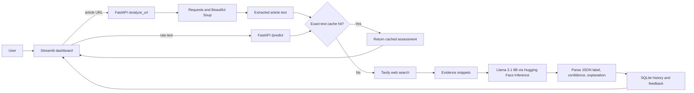

# Evidence-Grounded Misinformation Analysis System

A full-stack prototype for analyzing a raw claim or the text extracted from a news URL. The system retrieves current web evidence with Tavily, asks a Hugging Face-hosted Llama model for a structured assessment, and returns a `real`, `fake`, or `uncertain` label with a model-generated confidence value and explanation.

This project demonstrates an evidence-retrieval workflow; it is not a substitute for professional fact-checking. A verdict and confidence value are model outputs, not calibrated probabilities or independently verified ground truth.

## Features

- Raw-text and URL-based analysis
- Paragraph extraction from web pages with Beautiful Soup
- Tavily retrieval of up to three web-search results per analysis
- Structured LLM output through the Hugging Face Inference API
- FastAPI endpoints for analysis, accounts, history, feedback, and statistics
- Streamlit dashboard with per-user history and Plotly summaries
- SQLite persistence, bcrypt password hashing, and exact-text result caching
- Docker packaging, Kubernetes manifests, and an AWS-oriented deployment workflow
- Async API tests with `pytest`, `httpx`, and FastAPI's ASGI transport

## Architecture



## Data flow

1. The user signs up or logs in through the Streamlit interface.
2. For URL input, the backend fetches the page and joins text from its `<p>` elements.
3. The backend checks SQLite for an exact match of the analyzed text.
4. On a cache miss, Tavily retrieves current evidence snippets for the first 200 characters of the input.
5. The configured Hugging Face model compares the input with that evidence and is prompted to return JSON.
6. The backend stores the result in the user's history and exposes it to the dashboard.

## Repository structure

```text
.
├── backend/
│   ├── llm_judge.py       # Tavily retrieval and LLM assessment
│   ├── main.py            # FastAPI routes and request models
│   ├── scraping.py        # URL fetch and paragraph extraction
│   └── storage.py         # SQLite users, history, cache, and feedback
├── frontend/
│   └── app.py             # Streamlit dashboard
├── k8s/                   # Kubernetes deployment/service manifests
├── workflows/
│   └── deploy.yml         # AWS/ECR deployment workflow definition
├── data/                  # SQLite database location at runtime
├── DEPLOYMENT.md
├── Dockerfile
├── requirements.txt
└── test_main.py
```

## Installation

### Prerequisites

- Python 3.10 or newer
- A Tavily API key
- A Hugging Face token with access to the configured inference model
- Docker, if using the container workflow

### Environment variables

Create a `.env` file in the repository root:

```dotenv
TAVILY_API_KEY=your_tavily_key
HF_TOKEN=your_huggingface_token
HF_MODEL=meta-llama/Llama-3.1-8B-Instruct
```

Do not commit this file.

### Run with Docker

```bash
git clone https://github.com/Hamidreza4p/Miss-Information-Detection-System.git
cd Miss-Information-Detection-System

docker build -t misinfo-analysis .
docker run --rm --env-file .env -p 8000:8000 -p 8501:8501 misinfo-analysis
```

Open:

- Streamlit dashboard: `http://localhost:8501`
- FastAPI health endpoint: `http://localhost:8000/health`

The container starts Uvicorn and Streamlit in the same image. The SQLite database is written under `data/`; mount that directory if you need persistence beyond the container lifecycle.

### Run locally without Docker

```bash
python -m venv .venv
```

Activate the environment and install dependencies:

```bash
# Linux/macOS
source .venv/bin/activate

# Windows PowerShell
# .\.venv\Scripts\Activate.ps1

pip install -r requirements.txt
```

Start the backend and frontend in separate terminals from the repository root:

```bash
uvicorn backend.main:app --host 0.0.0.0 --port 8000
```

```bash
streamlit run frontend/app.py --server.port 8501
```

## API overview

| Method | Endpoint | Purpose |
|---|---|---|
| `GET` | `/health` | Service health check |
| `POST` | `/signup` | Create a local user account |
| `POST` | `/login` | Verify credentials and return the local user ID |
| `POST` | `/predict` | Analyze raw text |
| `POST` | `/analyze_url` | Extract and analyze an article URL |
| `GET` | `/history` | Return a user's recent analyses |
| `GET` | `/stats` | Return per-user label percentages |
| `POST` | `/update_feedback` | Add feedback to an analysis record |
| `POST` | `/clear_history` | Delete a user's stored analysis history |

## Testing and evaluation

Run the current automated tests with the same required environment variables available:

```bash
pytest -q test_main.py
```

The test module checks:

- API reachability through an in-process ASGI client
- The `/predict` response contains `label` and `confidence`
- The prediction path attempts to store a result
- `HF_MODEL` is configured

The prediction test calls the configured retrieval and inference services; it is not a fully isolated unit test.

### Reported course-project evaluation

The February 2026 project report documents a closed-ended evaluation on 20 fact-checked claims sourced from professional fact-checking outlets. The set contained 13 false and 7 true claims. `uncertain` was evaluated both as an incorrect answer under strict scoring and as an abstention under selective scoring.

| Metric | Reported result |
|---|---:|
| Strict accuracy (`uncertain` counted as incorrect) | 16/20 (80%) |
| Coverage (decisive `real` or `fake` responses) | 16/20 (80%) |
| Selective accuracy on decisive responses | 16/16 (100%) |
| Abstention rate | 4/20 (20%) |
| False claim predicted as real | 0/13 (0%) |
| True claim predicted as fake | 0/7 (0%) |

Reported prediction counts were:

- Ground-truth true: 6 `real`, 0 `fake`, 1 `uncertain`
- Ground-truth false: 0 `real`, 10 `fake`, 3 `uncertain`

These figures describe one small course-project evaluation, not general model performance. The benchmark claims, source links, dates, configuration snapshot, and machine-readable run outputs are not currently committed to this repository, so the result cannot yet be independently reproduced from the repository alone. A stronger evaluation package should publish those artifacts and additionally measure retrieval quality, JSON-parse failures, latency, calibration, and API-error behavior.

## Deployment notes

The repository includes Kubernetes manifests and an AWS/ECR-oriented workflow. Review all account IDs, host addresses, repository URLs, secret names, and storage paths in `DEPLOYMENT.md`, `k8s/`, and `workflows/deploy.yml` before use.

GitHub only discovers Actions workflows under `.github/workflows/`. The current workflow is stored under `workflows/`, so move it to `.github/workflows/deploy.yml` and update its repository-specific values before treating it as active CI/CD.

## Current limitations

- Web extraction reads paragraph elements and can fail on paywalls, client-rendered sites, or anti-bot controls.
- Evidence quality depends on the search query, returned sources, and the current state of the web.
- The parser falls back to `uncertain` when inference or JSON extraction fails.
- Exact-text caching is global across users and does not account for evidence changing over time.
- The displayed confidence is generated by the LLM and is not calibrated.

## License

Licensed under the GNU General Public License v3.0. See [LICENSE](./LICENSE).

